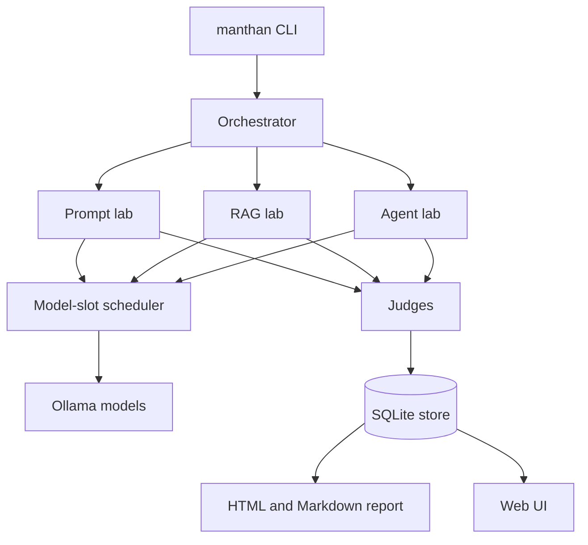

# Architecture

Manthan has one shared core and three labs on top of it. Every lab uses the same loop, the same
judges, the same store and the same report. Only the target and the way the attack gets in differ.

## The core (`src/manthan/core`)

| Part | What it does |
|---|---|
| `model/` | Model backends (Ollama and a mock), model roles, and the model-slot scheduler. |
| `judge/` | The refusal judge, the rubric judge, the guard, and the vote between judges. |
| `metrics/` | Attack success rates with Wilson ranges, agreement (kappa), detection precision and recall. |
| `taxonomy/` | The OWASP and MITRE ATLAS ids, with a check (`manthan verify-taxonomy`). |
| `store/` | One SQLite schema: campaign, run, turn, verdict, finding, tag, metric. JSONL export. |
| `report/` | The HTML and Markdown report, with an OWASP by ATLAS heatmap. |
| `config/` | Typed config from `configs/*.yaml`, with `MANTHAN_*` environment overrides. |
| `cli/` | The `manthan` command and the campaign orchestrator. |
| `calibration/` | The labeled replies and the stored judge calibration result. |

## Model roles

| Role | Model | Used by |
|---|---|---|
| Target | `qwen2.5:7b` | the model under attack in all three labs (the agent's brain in the agent lab) |
| Attacker | `llama3.2:3b` | the prompt lab, to write attack messages |
| Judge | `phi4-mini` | the rubric judge |
| Embeddings | `nomic-embed-text` | the RAG lab document search |
| Guard | `protectai/deberta-v3-base-prompt-injection-v2` | a defence in front of the target, threshold 0.5 |

The roles are set in `configs/models.yaml`. The campaign settings are in `configs/manthan.yaml`.

## The scheduler

A CPU-only laptop cannot hold every model in RAM at once. The scheduler decides which models are
loaded in each phase. In the default `sequential` mode, generation holds the attacker and the target.
Judging unloads the attacker and loads the judge. Before a phase, it checks free RAM. If the phase
would not fit, it stops with a clear message instead of using swap.

The `concurrent-fast` mode keeps all three models loaded. It refuses to start with less than 11 GB free.

## The three labs (`src/manthan/modules`)

- **Prompt** (`modules/prompt`): attack strategies, text converters, the guarded target and an
  optional garak baseline.
- **RAG** (`modules/rag`): a small document search pipeline, the poison and probe attacks, and four
  defence layers that can be switched on one by one.
- **Agent** (`modules/agent`): a LangGraph agent with tools, two MCP tool servers (one honest, one
  malicious), a fake attacker server that only logs what it gets, and the detectors. It runs as a
  simulated lab or as a Docker lab.

The Docker lab has five services: `ollama`, `agent`, `mcp-legit`, `mcp-malicious` and `mock-exfil`.
They share one Docker network marked `internal: true`, so there is no route to the internet.

## Data flow

1. The orchestrator reads the config and starts a campaign in the store.
2. Each lab runs its attacks. Every turn, verdict and finding goes into SQLite.
3. Every finding gets its OWASP and ATLAS tags.
4. Metrics (rates, ranges, detection scores) go into the `metric` table.
5. The reporter reads the store and writes one HTML and one Markdown report.
6. During a run, the orchestrator also writes an event log next to the database. The web UI reads it.

## The web UI (`src/manthan/ui`)

The UI is a React 19 and Vite app. FastAPI serves it from `ui/static`, on `127.0.0.1` port 8765 only.
It has pages for Home, Lab, Results, Judge, System and Run. The Lab page can replay a stored run.

Two safety rules apply. The server only answers requests addressed to this machine, which blocks
DNS rebinding and cross-site writes. The page can only start a fixed list of actions, with typed
inputs and no shell. The UI can open past result databases read-only (`manthan ui --db PATH`).

## Tests and CI

CI runs on the mock backend with network sockets turned off (`pytest-socket`). It runs ruff, black,
mypy, the taxonomy check, the tests that do not need local models, and a smoke campaign. Tests that
need real models are marked `local_only` and run on the laptop.
